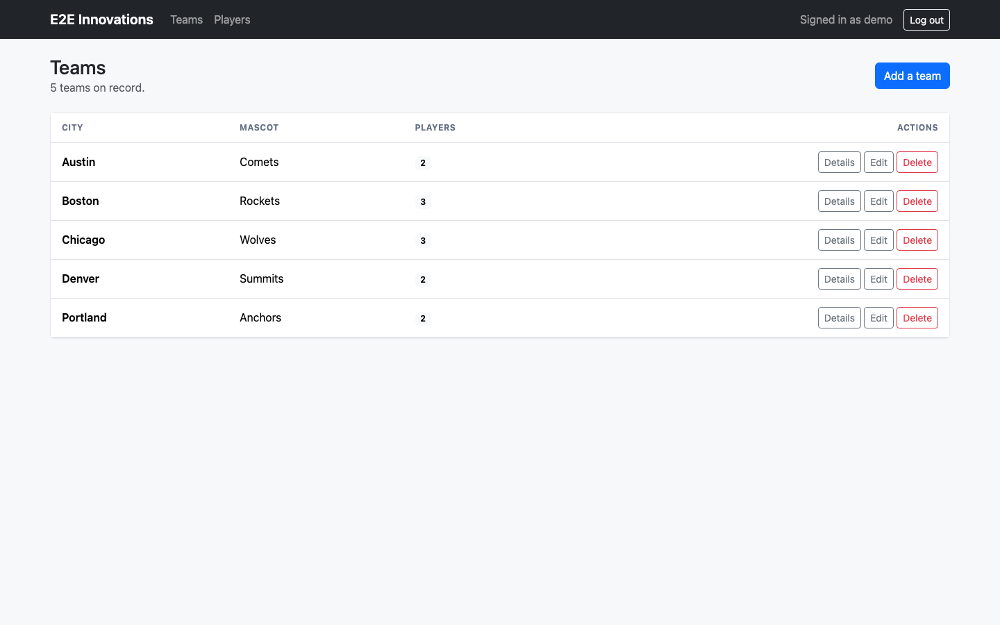

# Sports Roster

A Django app for managing sports teams and their players. Teams have a city and a mascot, players have a name, and a player can be on more than one team's roster. Everything sits behind a login. This was a coding exercise for E2E Innovations (the name in the navbar), so "E2E" refers to the client, not end-to-end testing.



What you can do:

- Create, edit and delete teams and players
- Assign players to multiple teams and see each team's roster
- Sign up, log in and log out
- Browse paginated team and player lists

It uses Django 4.2 with class-based views, server-rendered Bootstrap 5 templates and SQLite. Gunicorn serves it in the container.

## Getting started

```bash
python3 -m venv .venv && source .venv/bin/activate
pip install -r requirements.txt

export DJANGO_SECRET_KEY="$(python -c 'from django.core.management.utils import get_random_secret_key as k; print(k())')"
python manage.py migrate
python manage.py seed_demo_data
python manage.py runserver 127.0.0.1:8500
```

Then open http://127.0.0.1:8500/ and log in as `demo` / `demo-password-123`. The seed command creates a few teams and players along with that user.

`DJANGO_SECRET_KEY` is required. With `DJANGO_DEBUG` off the app won't start without it.

There is also a `Dockerfile` and `docker-compose.yml`. With the secret key exported, `docker compose up --build` should serve the app on http://localhost:8500/. The container setup has had less testing than the local run.

### Configuration

Settings come from environment variables (see `.env.example`):

- `DJANGO_SECRET_KEY` (required)
- `DJANGO_DEBUG`, default `0`
- `DJANGO_ALLOWED_HOSTS`, default `localhost,127.0.0.1,[::1]`
- `DJANGO_CSRF_TRUSTED_ORIGINS`
- `DJANGO_SECURE_SSL`, turns on HTTPS redirect, secure cookies and HSTS
- `DJANGO_DB_PATH`, location of the SQLite file
- `DJANGO_LOG_LEVEL`, default `INFO`
- `SPORTS_PAGE_SIZE`, default `25`

## Tests

```bash
pip install -r requirements-dev.txt
pytest
ruff check .
```

The tests also need `DJANGO_SECRET_KEY` set. They cover models, auth, views, settings and query counts.

## Code layout notes

Views in `sports/views.py` stay thin and get their querysets from `sports/selectors.py`, which handles prefetching and annotations. This keeps the player list at a fixed number of queries no matter how many rows there are. `scripts/benchmark_roster.py` compares it against a naive queryset, and a sample run is saved in [docs/benchmark.txt](docs/benchmark.txt).

## Limitations

- Any logged-in user can edit or delete anything, there are no roles.
- Signup is open with no email verification.
- No search, just pagination.
