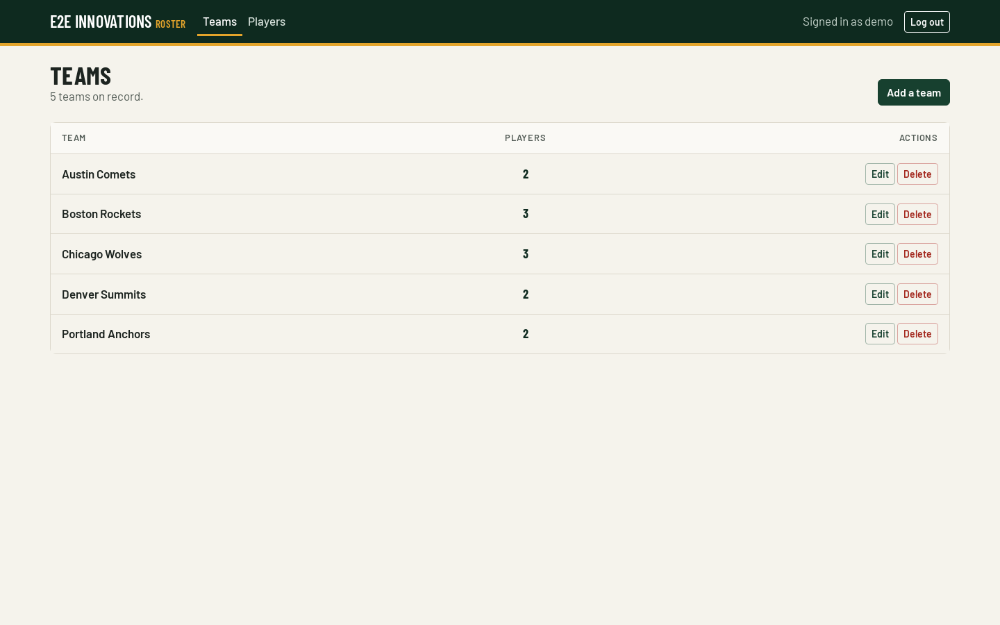
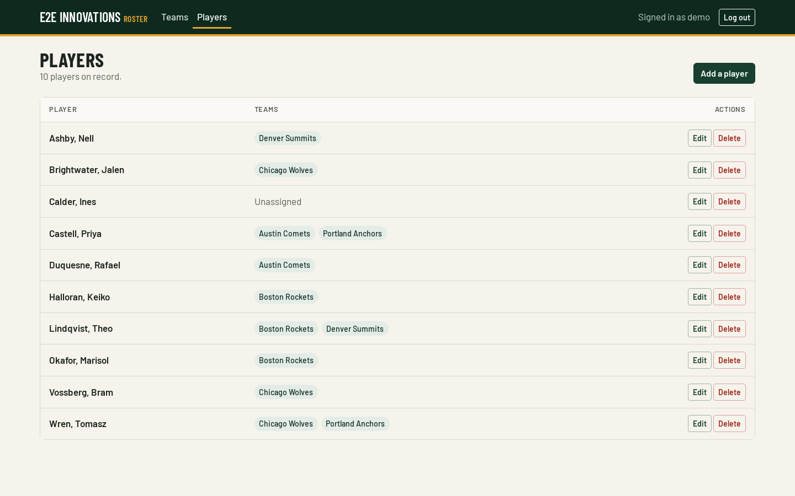
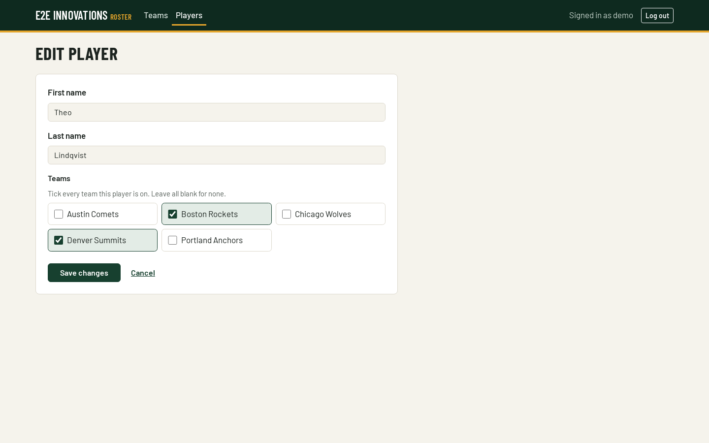
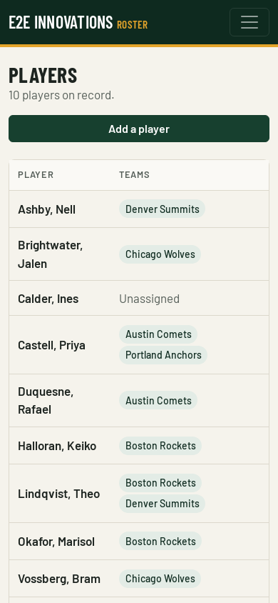
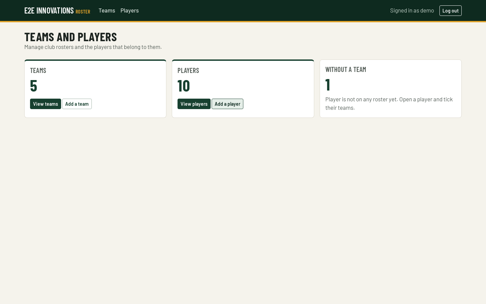
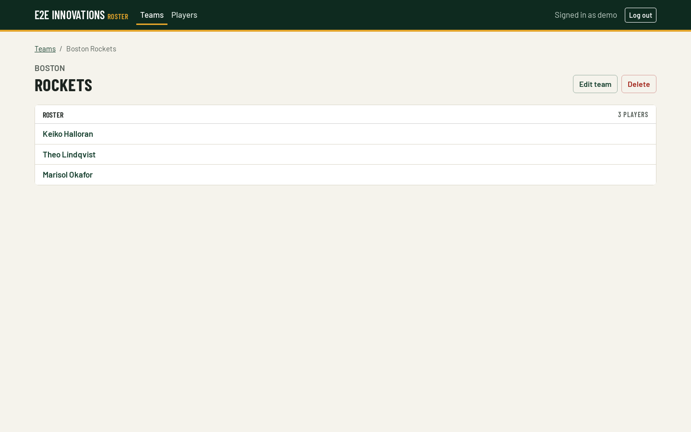
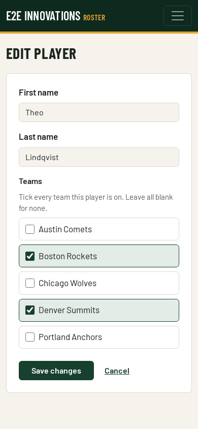
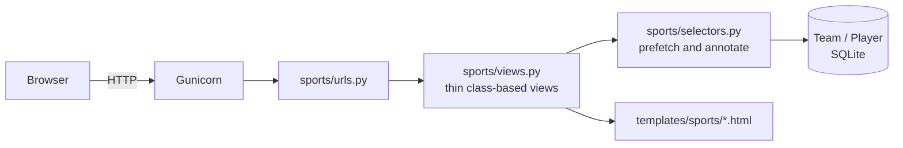

# Sports Roster

A Django app for managing sports teams and their players. A team is a city plus a mascot, a player has a first and last name, and one player can sit on several teams' rosters at once. Everything sits behind a login.

This was a coding exercise for E2E Innovations (the name in the navbar), so "E2E" refers to the client, not end-to-end testing.



## What it does

- Create, edit and delete teams and players
- Put a player on any number of teams by ticking checkboxes, and see each team's roster
- An overview page with team and player totals and how many players have no team yet
- Sign up, log in and log out (logout is POST-only)
- Paginated team and player lists, with a confirmation message after every save or delete
- A `/healthz/` endpoint that also checks the database, used by the container healthcheck

Team names are unique regardless of case, so "boston rockets" is rejected when "Boston Rockets" already exists.

It runs on Django 5.2 LTS and Python 3.12, with class-based views, server-rendered Bootstrap 5 templates, SQLite, and Gunicorn in the container.

| Players | Editing a player | On a phone |
| --- | --- | --- |
|  |  |  |
| **Overview** | **Team roster** | **Player form on a phone** |
|  |  |  |

## Running it with Docker Compose

This is the shortest path and needs only Docker:

```bash
export DJANGO_SECRET_KEY="$(python3 -c 'import secrets; print(secrets.token_urlsafe(50))')"
docker compose up --build -d
docker compose exec web python manage.py seed_demo_data
```

Open http://localhost:8500/ and log in as `demo` / `demo-password-123`. The seed command creates five teams, ten players with invented names, and that user. Running it again changes nothing.

The container runs migrations on start and keeps the SQLite file on the `sqlite-data` volume, so data survives `docker compose down`. Add `-v` to wipe it. To use another port, set `WEB_PORT` before `up`.

Compose refuses to start without `DJANGO_SECRET_KEY`. You can also put it in a `.env` file next to `docker-compose.yml`; `.env.example` lists every variable.

The health probe needs no login:

```bash
curl -s http://localhost:8500/healthz/
```

```json
{"status": "ok", "database": "ok"}
```

## Running it with a local Python

```bash
python3.12 -m venv .venv && source .venv/bin/activate
pip install -r requirements.txt

export DJANGO_SECRET_KEY="$(python -c 'import secrets; print(secrets.token_urlsafe(50))')"
python manage.py migrate
python manage.py seed_demo_data
python manage.py runserver 127.0.0.1:8500
```

With `DJANGO_DEBUG=1` the app falls back to a development key and the export can be skipped. With debug off, which is the default, it won't start without one.

### Configuration

All settings come from environment variables:

| Variable | Default | Purpose |
| --- | --- | --- |
| `DJANGO_SECRET_KEY` | none | Required unless `DJANGO_DEBUG=1` |
| `DJANGO_DEBUG` | `0` | Debug mode |
| `DJANGO_ALLOWED_HOSTS` | `localhost,127.0.0.1,[::1]` | Comma-separated host names |
| `DJANGO_CSRF_TRUSTED_ORIGINS` | empty | Needed when the app sits behind a proxy on another origin |
| `DJANGO_SECURE_SSL` | `0` | HTTPS redirect, secure cookies and HSTS |
| `DJANGO_DB_PATH` | `db.sqlite3` | SQLite file location (`/data/db.sqlite3` in the image) |
| `DJANGO_LOG_LEVEL` | `INFO` | Root log level |
| `SPORTS_PAGE_SIZE` | `25` | Rows per page on the lists |
| `WEB_PORT` | `8500` | Host port for Compose |
| `GUNICORN_WORKERS` | `3` | Worker count in the container |

## Tests and lint

```bash
pip install -r requirements-dev.txt
pytest
ruff check . && ruff format --check .
```

`pytest` uses `sportsapp/settings_test.py`, which supplies a throwaway key, so there is nothing to export first. The 65 tests cover models and constraints, auth and redirects, every view, the seed command, settings parsing, the error pages and query counts.

## How it is put together



- Views stay thin. They name a template and get their querysets from `sports/selectors.py`, which owns the prefetching and the aggregate counts. The player list costs the same number of queries for 10 rows or 1,000, and `sports/tests/test_performance.py` asserts that.
- `scripts/benchmark_roster.py` compares the selector against a naive queryset. A run inside a `python:3.12-slim` container is saved in [docs/benchmark.txt](docs/benchmark.txt): at 1,000 players the naive version issues 1,001 queries against the selector's 2.
- The player/team link is a plain many-to-many with `related_name='players'`, so templates read `team.players`.
- The 500 page renders without the request context. If the database is what failed, the error page doesn't need it.
- Styling is a single `<style>` block in `base.html` on top of Bootstrap from a CDN. The app has no static files of its own, so Gunicorn needs no static file server.

## Limitations

- Any logged-in user can edit or delete anything. There are no roles.
- Signup is open, with no email verification.
- No search, only pagination.
- Bootstrap and the Google Fonts load from CDNs, so a fully offline machine gets unstyled pages.

## License

MIT, see [LICENSE](LICENSE).
